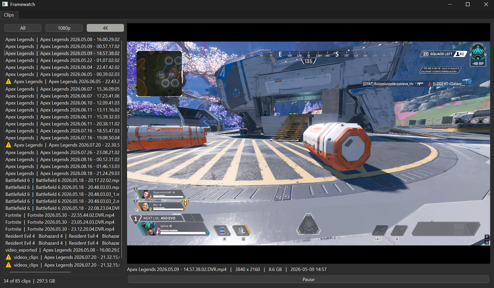

# Framewatch

Review and clean up your game clips quickly and efficiently. Framewatch automatically finds video clips in your Videos folder, allowing you to browse through them using the arrow keys and delete unwanted clips without having to open and close each video individually.

Framewatch also detects corrupted video files and stores their information in the application's Roaming AppData directory. This allows the application to remember previously detected corrupted files between sessions, so you don't have to identify them again every time you launch Framewatch.




## Install


## Tech stack

| Layer            | Tool                                      |
|------------------|-------------------------------------------|
| Language         | C++20                                     |
| Compiler         | MSVC               |
| UI framework     | Qt 6.8.3 (Widgets, Multimedia)            |
| Build system     | CMake 4.3                                 |
| Package manager  | vcpkg                                     |
| Capture API      | Windows.Graphics.Capture                  |
| Encoder          | NVENC via FFmpeg                          |
| Computer vision  | OpenCV + Tesseract                        |

## Build from source

You need Visual Studio 2022 or newer with the C++ workload, Qt 6.8.3 for MSVC
(with Qt Multimedia) in `C:\Qt\6.8.3`, and vcpkg with `VCPKG_ROOT` set.

From the **x64 Native Tools Command Prompt for VS**, in the project folder:

```bat
cmake --preset msvc-release
cmake --build build/release
cmake --install build/release --prefix "%CD%\dist\Framewatch"
```

`dist\Framewatch` is then a complete copy of the app, with Qt, FFmpeg and the
C++ runtime included. Zip that folder to make a release. The `--prefix` path
must be a full path, which is why the command uses `%CD%`.

